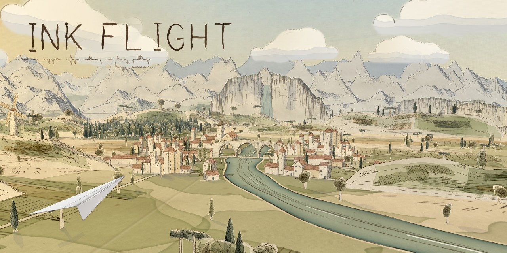
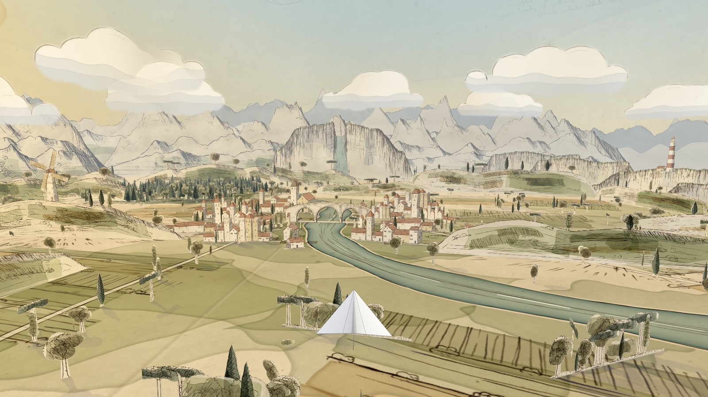
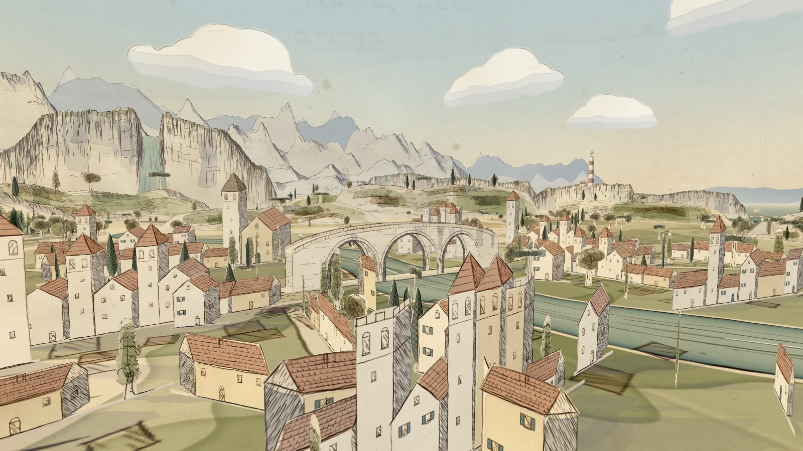
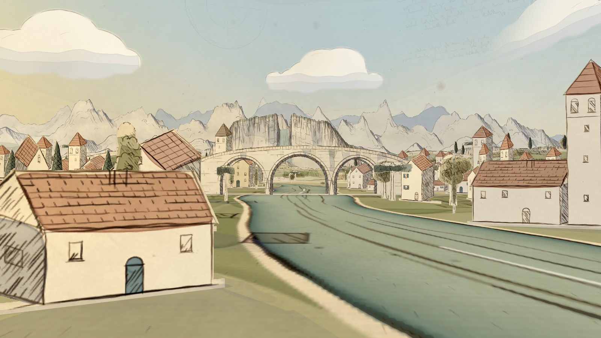
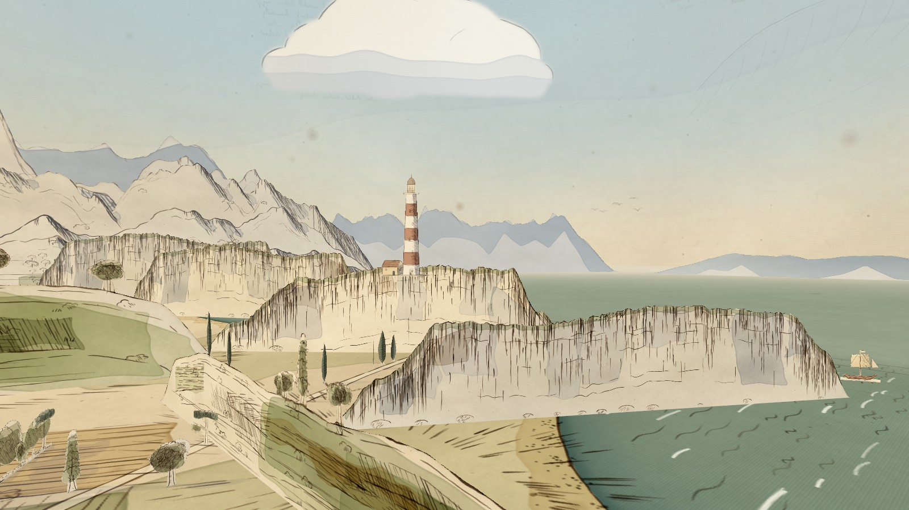
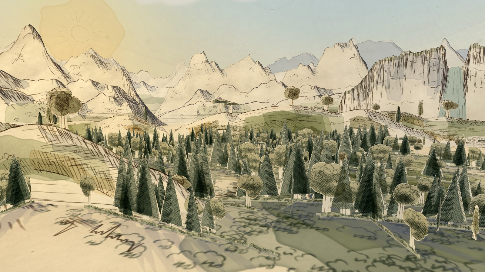
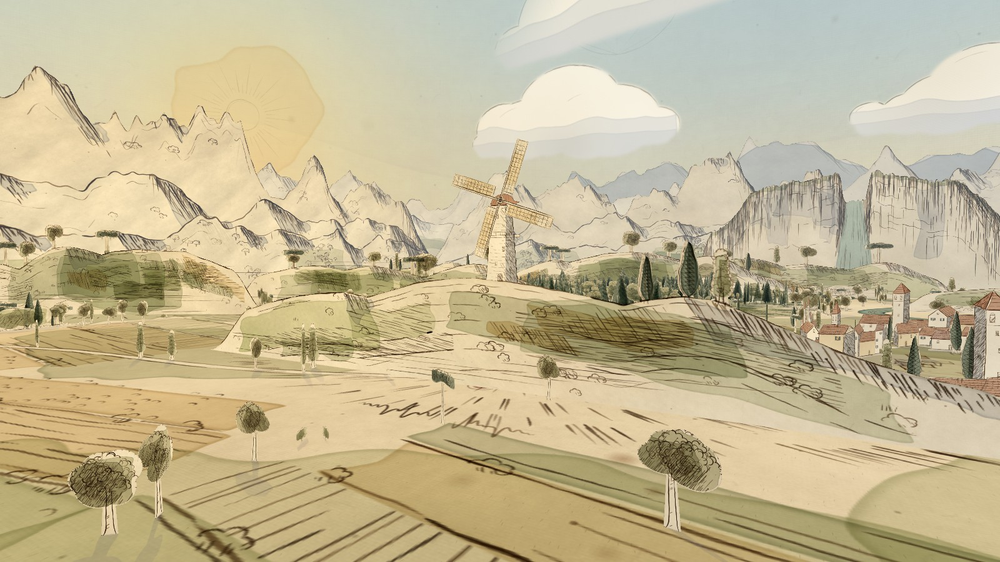

# Ink Flight



Fly a folded white paper plane through an explorer's sketchbook that has stood up off the page.

Everything in the valley is ink and restrained watercolour on old yellowed paper, the way a painter tints an ink sketch: ink-hatched mountains fading into blue haze, a teal river, a pen-drawn town with terracotta roofs and a stone bridge, a windmill, a lighthouse on a cliff, a forest in green ink. The world is made of flat drawn sheets standing in space like a theatre set, so flying through it has real depth and parallax. Clouds smudge where you fly through them. Wind is drawn as pencil strokes. It is late afternoon and the sun comes through the paper.

There is no score, nothing to collect and no way to fail. One valley, no people, no words.

| | |
|---|---|
|  |  |
|  |  |
|  |  |

## Run it

You need [Node](https://nodejs.org) 20 or newer and [pnpm](https://pnpm.io).

```sh
pnpm install
pnpm dev
```

Then open the address it prints (http://127.0.0.1:5173 by default) and click **Start flying**.

For a production build:

```sh
pnpm build
pnpm preview
```

It renders with three.js on WebGPU and falls back to WebGL 2 where WebGPU is missing.

## Controls

Mouse and keyboard work together.

| Input | What it does |
|---|---|
| Click | Lock the mouse and fly. `Esc` releases it and pauses; click again to carry on |
| Mouse left / right | Bank and turn |
| Mouse forward / back | Pitch: forward lifts the nose |
| `W` / `S` | Pitch: `W` pushes the nose down, `S` pulls it up |
| `A` / `D` | Bank and turn |
| `Shift` | Catch a gust and speed up; hold it and gusts keep coming |
| `Space` | Level out |
| `M` | Mute |
| `R` | Back to the start |

Arrow keys work too, and any flying key starts the game if you would rather not use the mouse. The mouse is a soft stick: it eases back to centre when your hand is still, so the plane levels itself. Sensitivity is `mouseSens` in `TUNE` at the top of `src/flight.js`. The plane is light: pull up for too long and it slows, mushes, and lets its own nose down until it is flying again. Look for the pencil curls that mark rising air over the town, the fields and the sea cliff. If you touch the ground you only skim it.

### URL options

| | |
|---|---|
| `?hud=0` | No start screen, hints or key legend: clean for recording, and it starts flying at once |
| `?invert=1` | Flips pitch on both the keys and the mouse |
| `?cam=town` | A fixed camera: `hero`, `town`, `mill`, `light`, `forest`, `falls`, `clouds`, `low`, `west`, `back` |
| `?freeze=1` | Draw one still frame and stop |
| `?light=0` | The drawings alone, with the light-through-paper pass off |
| `?debug=1` | Log the GPU adapter and frame stats |
| `?webgl=1` | Use the WebGL 2 backend instead of WebGPU |
| `?gallery=land` | The drawings laid flat: `land`, `trees`, `town`, `ground`, `marks` |

## How it is made

- **Every mark is drawn by code.** `src/draw/` holds a seeded pen: tapered strokes that darken and fade with the ink left on the nib, slanted hatching, washes that pool at their wet edge, pencil with paper tooth. There are no image, model or audio files in the game.
- **Colour is paint.** Washes are laid over the ink in the drawings themselves, in patches with wet edges, never as a filter. Distance cools and pales each rank of mountains. The palette is in the art direction.
- **Sheets, not models.** `src/world.js` stands about 590 flat sheets from 64 drawings on a map drawn on the ground. A sheet thins away as it turns edge-on to you. The plane is the only folded, three-dimensional thing.
- **Light through paper.** Nothing is lit in the usual sense. A sheet between you and the sun glows warm and shows its fibres; from its sunlit side it is pale; from behind you see the drawing faint and mirrored.
- **Flight.** `src/flight.js` is an energy model tuned by hand rather than a physics simulation: pitch trades height for speed, drag grows with speed, and a stall is a rule that lowers the nose.
- **Loader.** `src/loader.js` is a pen drawing a paper dart as far as the real loading has got; the sheet then folds along those lines and flies to where the plane sits in the first frame.
- **Sound.** `src/audio.js` makes wind, paper rustle, the pencil scratch of a bank and a sparse tune from noise and oscillators.

The art direction, written from the reference drawings, and the notes from each screenshot round are in [docs/art-direction.md](docs/art-direction.md). The look is checked with the [world-taste](https://github.com/StarKnightt/world-taste) skill's browser check; [docs/before-after.jpg](docs/before-after.jpg) shows the first, all-beige version next to the tinted one.

Measured on a Ryzen 5 7600X with an RTX 4060 (WebGPU): 4.3 ms per frame at 1920×1080 and at 2560×1440, 95% of frames under 5.5 ms, timed with the GPU's work included.

## Credits

The look was studied from seven reference images. They were used for reference only: none of them is in this repository or in the game, and every drawing you see is generated.

Three have a recorded source and are in the public domain:

- Leonardo da Vinci, landscape of the Arno valley, pen and ink, 1473, from Wikimedia Commons (two scans of the same sheet).
- Leonardo da Vinci, a notebook sheet of machine studies with mirror writing, from Wikimedia Commons.

The other four came without a recorded source, so they are described here, not credited. Where a name appears it is only what the image looks like to me, and it has not been checked against a source:

- A landscape with ruins in pen and brown ink with brown wash. It looks 18th-century Italian; the artist is unknown.
- A bay in pen, ink and watercolour. It looks like John Webber's work from Cook's third voyage (1779), but that attribution is unverified.
- A detail of an old manuscript map of a coast. The place names match John White's *La Virginea Pars* (about 1585), but which map it is has not been verified.
- A photograph of a folded paper dart. Photographer and licence unknown.

The title is set in [Kristi](https://fonts.google.com/specimen/Kristi) (copyright 2010 Birgit Pulk) and the small print in [Caveat](https://fonts.google.com/specimen/Caveat) (copyright 2014 The Caveat Project Authors), both under the SIL Open Font License and bundled through Fontsource.

Built with [three.js](https://threejs.org) and [Vite](https://vite.dev).

## Support

If you enjoyed this, you can support my work:

<a href="https://buymeacoffee.com/prasenx"></a>
&nbsp;&nbsp;
<a href="https://github.com/sponsors/StarKnightt"></a>
